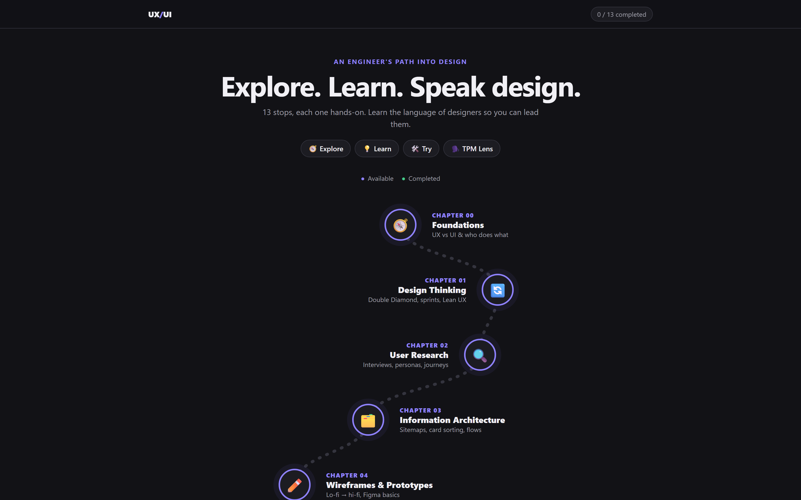

<div align="center">

# 🧭 UX/UI

**Explore. Learn. Speak design.**

A hands-on journey into UX/UI for engineers moving into product and project roles.



</div>

## How it works

Every chapter follows the same path:

🧭 **Explore** → 💡 **Learn** → 🛠️ **Try** → 🗣️ **TPM Lens**

Interactive demos, short bullets, no walls of text.

## Chapters

| | |
|---|---|
| 00 · [Foundations](chapters/00-foundations.html) | 07 · [Accessibility](chapters/07-accessibility.html) |
| 01 · [Design Thinking](chapters/01-design-thinking.html) | 08 · [Design Systems](chapters/08-design-systems.html) |
| 02 · [User Research](chapters/02-user-research.html) | 09 · [Design → Dev Handoff](chapters/09-handoff.html) |
| 03 · [Information Architecture](chapters/03-information-architecture.html) | 10 · [Testing & Metrics](chapters/10-testing-metrics.html) |
| 04 · [Wireframes & Prototypes](chapters/04-wireframes-prototypes.html) | 11 · [UX in Business](chapters/11-ux-in-business.html) |
| 05 · [Visual Design](chapters/05-visual-design.html) | 12 · [Capstone](chapters/12-capstone.html) |
| 06 · [Interaction & Heuristics](chapters/06-interaction-heuristics.html) | |

## Run it

Plain HTML, CSS and JavaScript. No install, no build.

**1. Get the code**

```bash
git clone https://github.com/<your-username>/explore-ux-ui.git
cd explore-ux-ui
```

**2. Start a local server** (pick one)

- **VS Code:** install the *Live Server* extension → right-click `index.html` → **Open with Live Server**
- **Node:** `npx serve .`
- **Python:** `python -m http.server 5500`

**3. Open it in your browser**

Go to the address your server shows (e.g. `http://localhost:5500`) and start from the journey map. Your progress is saved in the browser.
